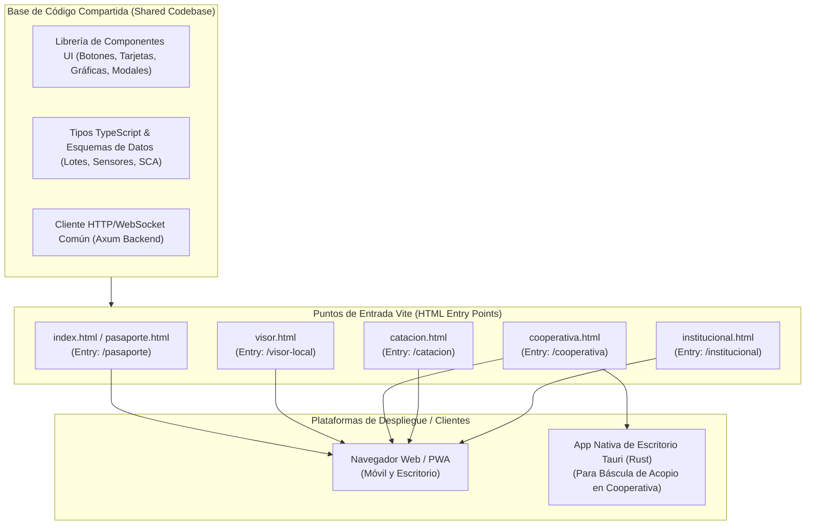
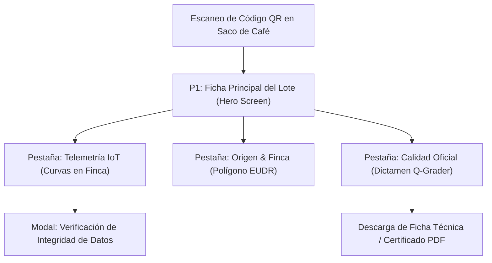
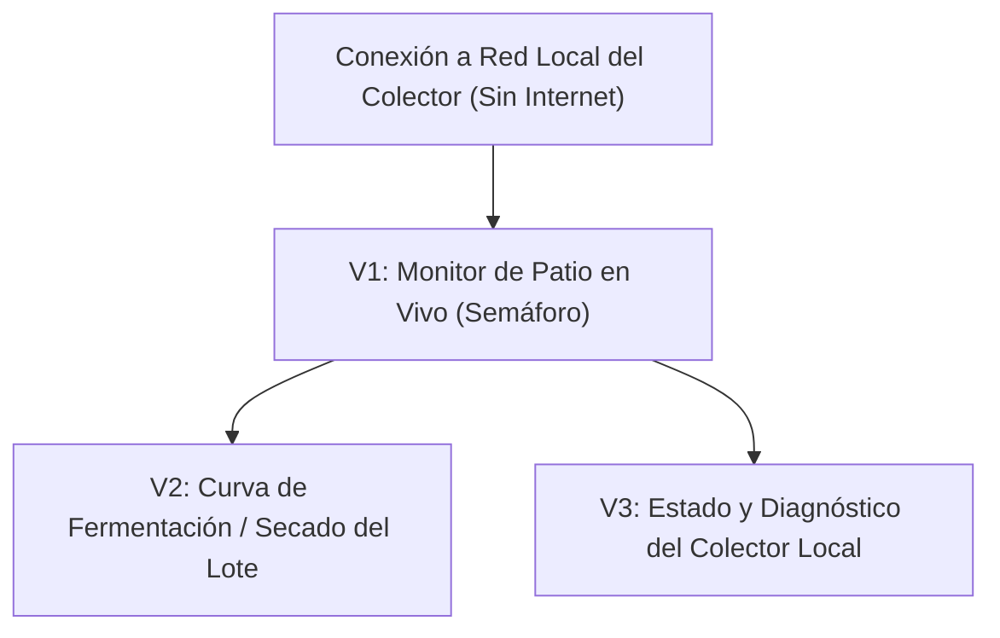
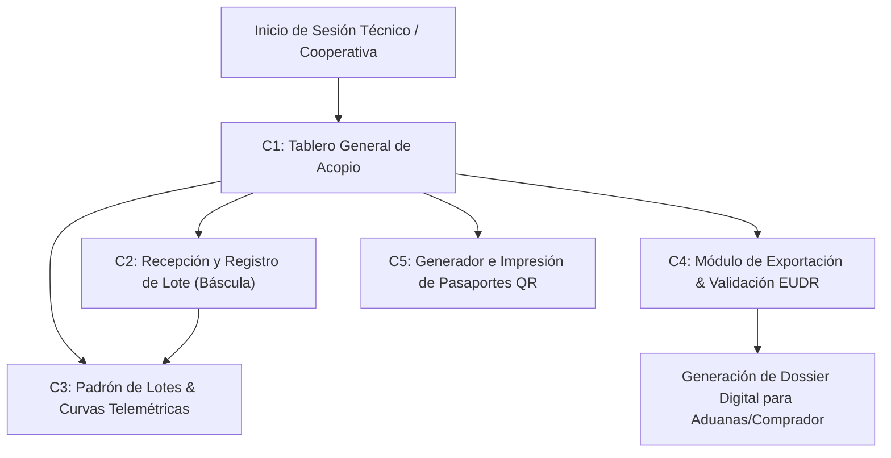
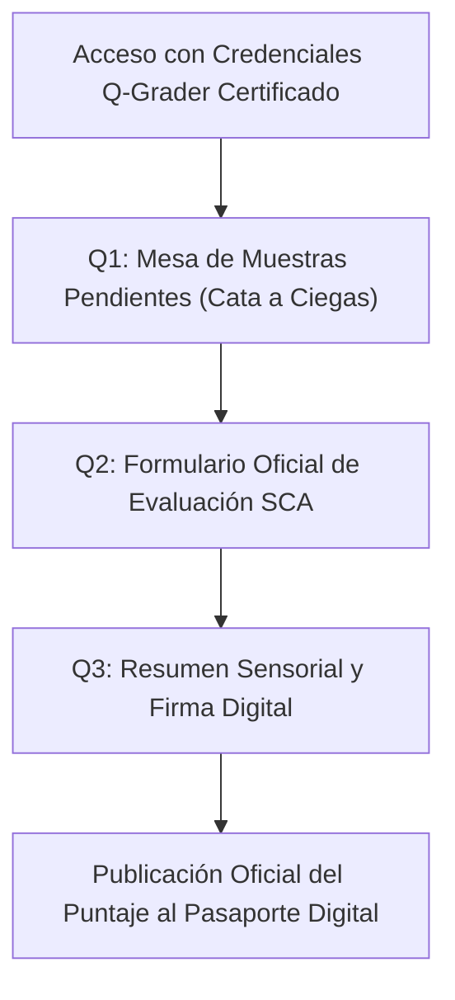
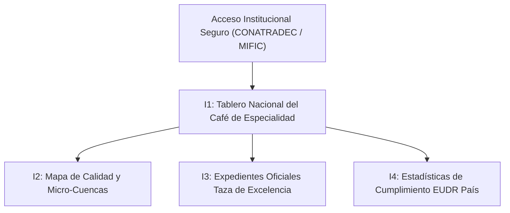

# SITRACAFE: Arquitectura Frontend Unificada y Flujos de Navegación por Entidad

Este documento define la estructura de navegación, pantallas y componentes de cada uno de los paneles frontend de **SITRACAFE (Sistema Inteligente de Trazabilidad de Café Especial)**.

---

## 1. Estrategia de Código Compartido y Puntos de Entrada (Multi-Entry Vite)

Todos los frontends de SITRACAFE conviven en un **único proyecto y base de código compartida** (Frontend Monorepo) gestionado con **Vite**. 

A través de la configuración de múltiples puntos de entrada (`entry points` en `vite.config.ts`), se compilan diferentes clientes según la plataforma de ejecución y el usuario final:



### Ventajas de este Enfoque
1. **Cero Duplicación de Código:** Los modelos de datos de telemetría (pH, temperatura, humedad), componentes visuales de semáforo y gráficas de curvas térmicas se programan una sola vez.
2. **Distribución Híbrida (Web + Tauri):** El punto de entrada de la cooperativa se puede abrir tanto desde un navegador web remoto como empaquetado en un instalador nativo ligero con **Tauri** para computadoras locales en la báscula de acopio.
3. **Cargas Ultraligeras:** Un comprador que escanea el código QR en un teléfono móvil sólo descarga los recursos del *Pasaporte Digital*, sin cargar los módulos pesados de administración de cooperativa ni de catación.

---

## 2. Mapa General de Frontends por Entidad

| Frontend | Usuario Objetivo | Dispositivo | Plataforma | Entrada Vite |
|---|---|---|---|---|
| **1. Pasaporte Digital de Lote** | Compradores internacionales, visitantes del stand | Smartphone (`390 × 844 px`) | Navegador Web (vía escaneo QR) | `/pasaporte/:lote_id` |
| **2. Visor Local del Productor** | Pequeño caficultor en patio/finca | Smartphone Android / Tablet | Web Local / PWA (Servida por Colector) | `/visor-local` |
| **3. Portal de Cooperativa** | Administrador de acopio, técnico de exportación | PC Escritorio / Laptop | Web HTTPS / App Desktop Tauri | `/cooperativa` |
| **4. Módulo de Catación** | Catador Certificado Q-Grader | Tablet táctil / Laptop | Web App de Laboratorio | `/catacion` |
| **5. Dashboard Institucional** | Directivos CONATRADEC / MIFIC | Monitor de oficina / PC | Web Portal Analítico | `/institucional` |

---

## 3. Desglose de Pantallas y Flujos de Navegación

### 3.1. Frontend 1: Pasaporte Digital de Lote (Público / Escaneo QR)
* **Objetivo:** Brindar certeza científica, trazabilidad inalterable y justificar el precio prémium de micro-lotes de especialidad ante compradores globales.
* **Dispositivo:** Pantalla móvil vertical (`~390 × 844 px`).



#### Pantallas Detalladas:
* **P1. Ficha Principal del Lote (Hero Screen):**
  - **Cabecera:** Identificador visible del lote (ej. `#DIP-2026-042`), nombre de la Finca (*El Paraíso*), región (*Dipilto, Nueva Segovia*) y altitud (*1,450 msnm*).
  - **Insignia Destacada 1:** `[SCA 88.5 · Evaluación Oficial Q-Grader]` con indicación de laboratorio acreditado externo.
  - **Insignia Destacada 2:** `[EUDR · Parcela Verificada Libre de Deforestación]`.
  - **Ficha Rápida:** Variedad botánica (*Geisha*), método de beneficiado (*Honey*), fecha de cosecha y peso del micro-lote.
* **Pestaña A. Telemetría IoT Verificada:**
  - Gráfica interactiva de curva térmica en patio/secadora solar (temperatura máxima de masa controlada $< 40^\circ\text{C}$).
  - Gráfica de acidificación de fermentación (curva de pH descendente desde $6.0$ hasta $4.3$ óptimo).
  - Humedad final del grano empacado ($11.2\%$).
  - Firma/Hash de registro capturado en origen por nodos ESP32.
* **Pestaña B. Origen & Trazabilidad Geográfica:**
  - Mapa satelital con el polígono georreferenciado de la parcela cafetalera.
  - Sello de validación de bosque intacto conforme a la normativa europea contra la deforestación (EUDR).
  - Perfil del caficultor y de la cooperativa comunitaria asociada.
* **Pestaña C. Calidad Oficial Externa:**
  - Desglose de notas sensoriales emitidas por el Q-Grader (acidez cítrica brillante, notas florales a jazmín, cuerpo meloso).
  - Aclaración visible: *"Evaluación sensorial realizada de forma independiente por catador certificado Q-Grader; SITRACAFE aloja y transparenta los datos"*.

---

### 3.2. Frontend 2: Visor Local del Productor (En Finca)
* **Objetivo:** Asistir al caficultor en el patio y pilas de beneficio para prevenir defectos biológicos y térmicos sin necesidad de conexión a internet.
* **Dispositivo:** Smartphone Android del productor o tablet local conectada a la red Wi-Fi/BLE del Colector Local.



#### Pantallas Detalladas:
* **V1. Monitor de Patio en Vivo (Semáforo Visual):**
  - **Pila de Fermentación Activa:**
    - Tarjeta grande con color de estado:
      - *Verde:* pH entre $4.2$ y $4.5$ (fermentación óptima).
      - *Amarillo:* pH en $4.1$ (aviso: preparar lavado).
      - *Rojo:* pH $< 4.0$ (alerta crítica: riesgo de sobrefermentación y pérdida de lote).
    - Temperatura actual de la masa en pila.
  - **Patio de Secado Activo:**
    - Temperatura actual del grano en secador solar (alerta si se acerca a $40^\circ\text{C}$).
    - Humedad estimada actual del grano.
* **V2. Curva del Lote en Curso:**
  - Gráfica temporal simple de las últimas 24 a 48 horas mostrando la evolución del pH y la temperatura para tomar la decisión informada de lavar el café.
* **V3. Diagnóstico del Colector Local:**
  - Conteo de lecturas guardadas localmente en memoria Flash/MicroSD (*Store & Forward*).
  - Estado de batería de los nodos sensores.
  - Indicador de estado del Gateway de enlace (*"Última sincronización a la nube: Hace 3 horas"*).

---

### 3.3. Frontend 3: Portal de Gestión de Cooperativa
* **Objetivo:** Recepción de cosechas, consolidación de micro-lotes, cumplimiento aduanero/EUDR y emisión de etiquetas QR para exportación.
* **Dispositivo:** PC de escritorio o laptop en oficina, o App Desktop empaquetada con **Tauri** conectada a la báscula de acopio.



#### Pantallas Detalladas:
* **C1. Tablero General de Acopio (Overview):**
  - Resumen de quintales acopiados en la temporada.
  - Total de micro-lotes activos clasificados por proceso (*Lavado*, *Honey*, *Natural*).
  - Indicador de consistencia técnica: porcentaje de lotes libres de incidentes térmicos o biológicos.
* **C2. Recepción y Registro de Lote:**
  - Formulario de entrada en báscula: selección del socio caficultor, pesaje certificado, fecha de corte y vinculación con el ID del Colector Local.
* **C3. Padrón de Lotes & Curvas Telemétricas:**
  - Tabla filtrable con todos los lotes recibidos.
  - Vista expandida de auditoría: gráficas de fermentación y secado descargadas desde el Colector del socio.
* **C4. Módulo de Exportación & Validación EUDR:**
  - Visualizador GIS de parcelas asociadas sobrepuestas con capas de cobertura forestal.
  - Generación del archivo GeoJSON / reporte de coordenadas obligatorio para exportar a la Unión Europea.
* **C5. Generador e Impresión de Pasaportes QR:**
  - Selección de lote verificado y generación de etiqueta gráfica lista para impresora térmica o industrial para adherir a los sacos de exportación.

---

### 3.4. Frontend 4: Módulo de Catación para Q-Graders
* **Objetivo:** Registro oficial e independiente de la evaluación sensorial según el protocolo estándar de la Specialty Coffee Association (SCA).
* **Dispositivo:** Tablet táctil o laptop en la mesa de catación del laboratorio.



#### Pantallas Detalladas:
* **Q1. Mesa de Muestras Pendientes:**
  - Muestras codificadas a ciegas (ej. Muestra `#M-08`) para asegurar imparcialidad.
  - Información visible para el catador: Variedad y método de proceso, sin revelar el nombre del productor durante la evaluación inicial.
* **Q2. Formulario Oficial de Evaluación SCA:**
  - Deslizadores (*sliders*) interactivos del 6.00 al 10.00 para los 10 atributos SCA:
    - *Tueste, Fragancia/Aroma, Sabor, Sabor Residual, Acidez, Cuerpo, Balance, Uniformidad, Taza Limpia, Dulzor*.
  - Matriz de casillas para marcado de tazas con defectos (fermento agresivo, fenol, moho).
  - Cuadro de notas descriptivas y rueda de sabores (frutos rojos, jazmín, miel, cacao).
* **Q3. Resumen Sensorial y Firma Digital:**
  - Cálculo en tiempo real del puntaje total (ej. $88.50\text{ puntos}$).
  - Número de licencia de Q-Grader y laboratorio emisor.
  - Botón de firma y publicación: vincula el puntaje al historial del lote en la base de datos de SITRACAFE.

---

### 3.5. Frontend 5: Dashboard Institucional (CONATRADEC / MIFIC / Gobierno)
* **Objetivo:** Monitoreo estadístico macro de la calidad del café de especialidad nacional, soberanía de datos y soporte documental para subastas internacionales.
* **Dispositivo:** Monitor de escritorio / PC institucional.



#### Pantallas Detalladas:
* **I1. Tablero Nacional del Café de Especialidad:**
  - Indicadores país: Volumen acumulado de café con puntaje SCA $\ge 84$ puntos.
  - Comparativa interanual de consistencia en procesos de beneficiado.
* **I2. Mapa de Calidad y Micro-Cuencas:**
  - Visualización por departamentos cafetaleros (Nueva Segovia, Jinotega, Matagalpa, Madriz).
  - Distribución geográfica de variedades de alta gama (*Geisha*, *Pacamara*, *Maracaturra*, *Bourbon*).
* **I3. Expedientes Oficiales Taza de Excelencia:**
  - Módulo de consulta rápida para jurados internacionales con la ficha técnica completa y verificada de los lotes participantes en subastas.
* **I4. Estadísticas de Cumplimiento EUDR País:**
  - Reporte consolidado de porcentaje de hectáreas auditadas libres de deforestación para respaldo diplomático y comercial en el exterior.

---

## 4. Estructura de Directorios Propuesta en el Proyecto Frontend (Vite)

Para implementar esta arquitectura sin duplicación de código, el proyecto frontend se estructura de la siguiente manera:

```text
frontend/
├── index.html                  # Punto de entrada 1: Pasaporte Digital Móvil (/pasaporte)
├── visor.html                  # Punto de entrada 2: Visor Local del Productor (/visor-local)
├── cooperativa.html            # Punto de entrada 3: Portal Cooperativa (/cooperativa)
├── catacion.html               # Punto de entrada 4: Módulo Q-Grader (/catacion)
├── institucional.html          # Punto de entrada 5: Dashboard CONATRADEC (/institucional)
├── src-tauri/                  # Configuración de Tauri (para compilar cooperativa.html nativo)
│   ├── tauri.conf.json
│   └── src/main.rs
├── vite.config.ts              # Configuración MPA con rollupOptions.input para cada entry
└── src/
    ├── shared/                 # Código compartido entre todos los frontends
    │   ├── components/         # Botones, Cards, Semáforos, Gráficas de Curvas (SVG/Canvas)
    │   ├── theme/              # Paleta Café de Especialidad (#3E2712, #1E5631, #C88A2C)
    │   ├── types/              # Interfaces TypeScript (Lote, Telemetria, EvaluacionSCA)
    │   └── api/                # Cliente HTTP para comunicarse con Axum (Rust)
    ├── pasaporte/              # Vistas exclusivas del Pasaporte Público
    ├── visor/                  # Vistas exclusivas del Visor Local en Finca
    ├── cooperativa/            # Vistas exclusivas del Portal de Cooperativa
    ├── catacion/               # Vistas exclusivas del Módulo de Catación SCA
    └── institucional/          # Vistas exclusivas del Dashboard CONATRADEC
```

---

## 5. Próximo Paso: Selección para Mockup en Stitch

Con esta navegación y jerarquía de pantallas formalizada, el primer mockup a generar en **Stitch** corresponde exactamente a la pantalla **P1 + Pestaña Telemetría** de la sección 3.1:
- **Pantalla:** Pasaporte Digital de Lote Móvil (`390 × 844 px`).
- **Contenido:** Lote `#DIP-2026-042`, Finca El Paraíso (Dipilto), Evaluación externa oficial Q-Grader SCA 88.5, telemetría verificada (pH 4.3 y secado 36.8 °C) y sello de conformidad EUDR.
