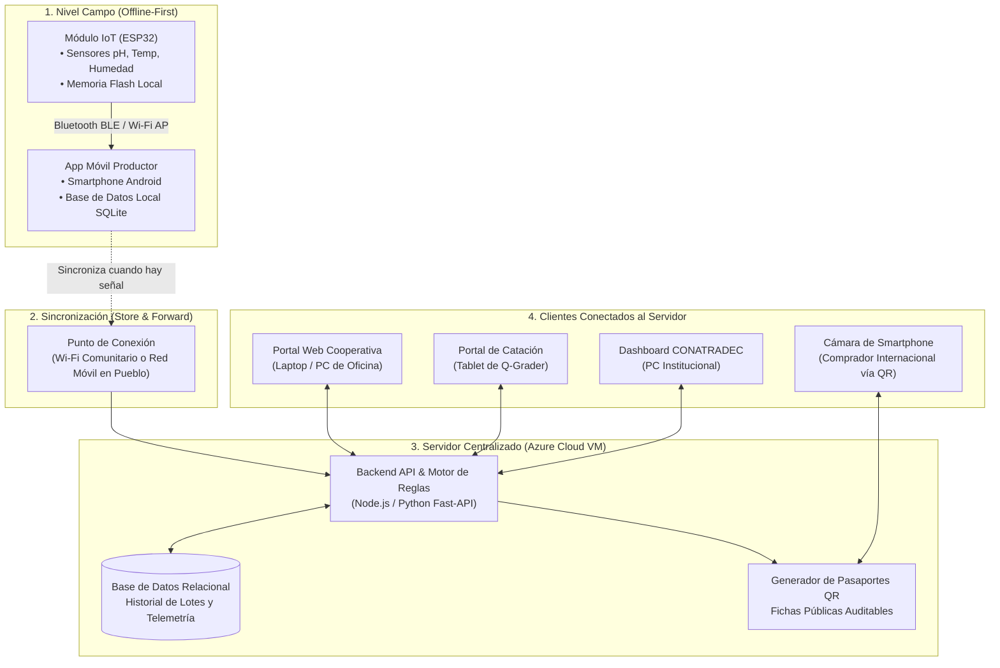

# SITRACAFE: Definición de Usuarios, Expectativas y Clientes de Acceso

Este documento detalla los **actores clave** del ecosistema **SITRACAFE (Sistema Inteligente de Trazabilidad de Café Especial)**, qué espera cada uno de la plataforma y cuáles son los dispositivos ("clientes") que utilizan para conectarse al servidor centralizado.

---

## 0. Clarificación Estratégica: ¿Por qué Exclusivamente Café Especial?

En la caficultura nicaragüense conviven dos realidades muy distintas:

1. **Café Comercial / Convencional (Commodity):**
   - Se vende a granel según el precio internacional de la Bolsa de Nueva York (Contrato C).
   - Los granos de diferentes fincas y calidades se mezclan sin distinción.
   - **No justifica una inversión en trazabilidad individual:** El margen de ganancia es estrecho y al comprador masivo no le interesa la historia de la parcela ni el monitoreo bioquímico del lote.

2. **Café Especial de Exportación (Specialty Coffee):**
   - Se comercializa en **micro-lotes diferenciados** (puntuación SCA $\ge 80$ puntos).
   - Los compradores internacionales (tostadores de alta gama en Europa, Asia y EE.UU.) están dispuestos a pagar precios prémium (hasta **US\$ 140 por libra** en subastas como *Taza de Excelencia Nicaragua*).
   - **La trazabilidad es el motor del valor:** El comprador internacional **exige conocer cada detalle:** quién lo cosechó, altitud exacta de la finca, variedad botánica (Geisha, Maracaturra, Pacamara), método de proceso (Lavado, Honey, Anaeróbico), curvas precisas de fermentación (pH) y secado térmico.
   - **Cumplimiento de exportación:** Regulaciones internacionales como la **EUDR** (Reglamento Europeo de Deforestación) exigen geolocalización inalterable de la parcela para permitir el ingreso a los mercados más lucrativos del mundo.

> **Principio de Diseño de SITRACAFE:** La tecnología IoT no se concibe como un gasto burocrático, sino como la **herramienta de defensa del precio justo** que transforma la telemetría en evidencia científica certificable para el mercado de especialidad.

---

## 1. Matriz General de Usuarios y Clientes

| Actor / Usuario | Rol en la Cadena | Dispositivo "Cliente" | Modo de Conexión | Qué Espera de la Plataforma |
|---|---|---|---|---|
| **Pequeño y Mediano Caficultor** | Captura en origen y control de calidad en finca | Módulo IoT (ESP32) + Smartphone (App Móvil Offline-First) | Bluetooth BLE / Wi-Fi Local $\rightarrow$ *Store & Forward* (sincroniza al tener señal) | Alertas de riesgo en vivo (pH y temperatura), cero pérdida de lotes por sobrefermentación, y certificación de origen para exigir mejor precio. |
| **Cooperativas Cafetaleras** | Acopio, consolidación de micro-lotes y gestión regional | Computadora de escritorio / Laptop / Tablet en acopio | Portal Web Administrativo (HTTPS) hacia Servidor Azure | Vista unificada de los lotes de todos sus socios, validación de normativas de exportación (EUDR) y reportes de calidad regional. |
| **Catadores Certificados (Q-Graders)** | Evaluación sensorial y puntuación de taza | Laptop / Tablet en laboratorio de catación | Portal Web / Módulo Sensorial (Web App) | Correlacionar variables físicas/químicas con notas de sabor, auditar consistencia del lote y registrar puntaje oficial SCA (ej. 88+). |
| **Instituciones (CONATRADEC / Gob.)** | Regulación, fomento cafetalero y soberanía de datos | Navegador Web / API de Integración Institucional | Portal Web de Estadísticas y Reportería País (REST API) | Soberanía técnica sobre los datos del café nicaragüense, estadísticas de cosecha y soporte documental para eventos internacionales. |
| **Comprador / Tostador Internacional** | Adquisición de micro-lotes prémium en el extranjero | Smartphone / Tablet de uso común (Cámara estándar) | Escaneo de Código QR físico en saco/empaque (Web pública ligera) | Transparencia auditable: historia del café, curvas reales de secado/fermentación, geolocalización y respaldo del precio prémium. |
| **Equipo de Soporte (Lubanic)** | Mantenimiento, calibración y administración técnica | Laptop / Consola de operaciones | SSH / Dashboard de telemetría y diagnósticos IoT | Monitoreo de estado de sensores (batería, calibración de electrodos pH) y estabilidad de la infraestructura cloud. |

---

## 2. Desglose Detallado por Tipo de Usuario

### 2.1. Pequeño y Mediano Productor Cafetalero
* **Perfil:** Agricultores en zonas montañosas de alta altitud (ej. Dipilto, Jalapa, Matagalpa, Jinotega). Frecuentemente operan sin conexión de datos móviles continua en sus patios de secado o pilas de fermentación.
* **Dispositivo Cliente:**
  - **Nodo de Hardware:** Módulo ESP32 con sensores industriales (pH sumergible, DS18B20 impermeable, SHT31 ambiental y celda de carga).
  - **Interfaz Móvil:** Aplicación móvil ligera para Android (o PWA) instalada en su teléfono celular.
* **Mecanismo de Conexión:**
  - Comunicación de corto alcance vía **Bluetooth Low Energy (BLE)** o **Wi-Fi en modo Punto de Acceso (AP)** generado por el mismo ESP32.
  - **Viabilidad Regulatoria en Nicaragua:** Se descartan formalmente enlaces de radio de largo alcance tipo LoRa (sub-GHz) para evitar trámites de licencias y concesiones de espectro radioeléctrico ante el ente regulador (TELCOR). Para un desglose técnico y legal completo, consultar [Nota Técnica y Regulatoria: Justificación del Descarte de LoRa](nota-regulatoria-lora.md). Bluetooth BLE y Wi-Fi en 2.4 GHz operan en bandas libres universales, son 100% legales y compatibles de fábrica con cualquier smartphone.
  - **Offline-First:** El módulo y el teléfono almacenan las lecturas localmente en memoria no volátil (*Store & Forward*). Cuando el productor se desplaza al pueblo o a la sede de la cooperativa donde hay señal Wi-Fi o red móvil, los datos se sincronizan automáticamente con el servidor central.
* **Expectativas Principales:**
  - **Prevención de pérdidas:** Recibir un aviso visual o sonoro en el teléfono antes de que la masa de café sobrepase los $40^\circ\text{C}$ o el pH caiga por debajo de $4.0$.
  - **Simplicidad:** No tener que configurar redes complicadas ni pagar suscripciones mensuales en dólares.
  - **Poder de negociación:** Presentar un reporte objetivo al comprador para demostrar que su café califica en el rango de alta especialidad.

---

### 2.2. Administrador / Técnico de Cooperativa
* **Perfil:** Encargados de control de calidad, acopio y exportación de asociaciones comunitarias.
* **Dispositivo Cliente:**
  - Computadora de escritorio o laptop en la oficina central de la cooperativa.
  - Tablet industrial o terminal en la báscula de recepción de grano.
* **Mecanismo de Conexión:**
  - Conexión a internet mediante navegador web estándar a la URL del portal administrativo centralizado en Azure.
* **Expectativas Principales:**
  - **Visibilidad integral:** Dashboard en tiempo real que liste todos los lotes entregados por sus socios caficultores.
  - **Cumplimiento EUDR:** Generar con un clic el mapa de polígonos de las parcelas para certificar que el café no proviene de zonas deforestadas.
  - **Estandarización:** Filtrar micro-lotes homogéneos para preparar contenedores de exportación homogéneos y consistentes.
  - **Cero dependencia:** No pagar licencias de software privativo extranjero como Cropster.

---

### 2.3. Catadores Certificados (Q-Graders) y Laboratorios
* **Perfil:** Especialistas sensoriales encargados de calibrar fragancia, aroma, sabor, acidez, cuerpo y balance de cada lote.
* **Dispositivo Cliente:**
  - Tablet o laptop táctil en la mesa del laboratorio de catación.
* **Mecanismo de Conexión:**
  - Interfaz web con formulario interactivo de evaluación homologado con el protocolo de la Specialty Coffee Association (SCA).
* **Expectativas Principales:**
  - Consultar de antemano el perfil técnico del lote (curva de fermentación y secado).
  - Ingresar notas organolépticas y puntaje final (ej. 86 a 90+ puntos).
  - Validar científicamente si una nota astringente o defecto fenólico fue originado por fallas térmicas durante el beneficiado.

---

### 2.4. Entidades Rectoras (CONATRADEC, MIFIC, INATEC)
* **Perfil:** Instituciones gubernamentales y sectoriales orientadas a la transformación de la caficultura nicaragüense.
* **Dispositivo Cliente:**
  - Portal institucional web y servicios de exportación de datos.
* **Mecanismo de Conexión:**
  - Navegador web corporativo y endpoints seguros API REST para analítica agregada.
* **Expectativas Principales:**
  - **Soberanía y Seguridad:** Custodiar la información agrícola estratégica dentro del país sin depender de servidores de terceros extranjeros.
  - **Datos Macroeconómicos:** Estadísticas consolidadas de rendimiento por micro-cuencas, volumen de café de especialidad y precios promedio obtenidos.
  - **Prestigio Internacional:** Evidencia auditable para respaldar las subastas electrónicas de *Taza de Excelencia*.

---

### 2.5. Compradores y Tostadores Internacionales
* **Perfil:** Importadores, cafeterías de tercera ola y tostadores boutique en Europa, Asia y Norteamérica que pagan precios récord (hasta US$ 140/lb).
* **Dispositivo Cliente:**
  - Smartphone personal (iPhone o Android) utilizando la cámara nativa sin instalar apps adicionales.
* **Mecanismo de Conexión:**
  - Escaneo óptico del código QR impreso en la etiqueta del saco de yute o en el empaque hermético.
  - Apertura inmediata del **Pasaporte Digital del Lote** (vista web ultraligera y responsiva).
* **Expectativas Principales:**
  - **Cero Falsificaciones:** Garantía de que el lote que recibió en el puerto corresponde exactamente al café catado y cosechado.
  - **Historia Completa:** Conocer el nombre de la finca, la altura (msnm), la variedad botánica y las gráficas interactivas de pH y secado térmico.
  - **Certificación Normativa:** Comprobar la geolocalización y el cumplimiento ambiental sin fricción.

---

## 3. Arquitectura de Conexión Cliente-Servidor

---

## 4. Conclusiones Técnicas para la Propuesta

1. **El Servidor Central no exige que la finca tenga internet:** Gracias al patrón *Store & Forward*, el sistema resuelve la principal brecha técnica del campo montañoso de Nicaragua.
2. **El cliente más importante para el comprador es el código QR:** No requiere descargar ninguna aplicación; cualquier teléfono moderno despliega el historial técnico en segundos.
3. **El cliente para el productor es de cero fricción:** La recolección de variables físicas se realiza automáticamente en hardware independiente hermético con protección IP67.
